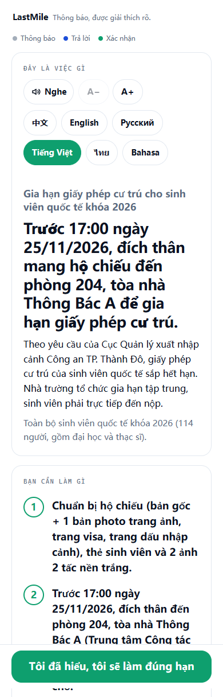
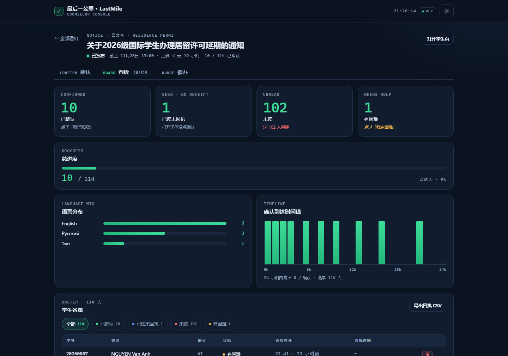

# 最后一公里 · LastMile

> 留学生通知的「签收与理解闭环」：一份中文通知进，一张看得懂、能确认、可追踪的多语卡片出。

36 小时黑客松「留学生通知的最后一公里」参赛作品。学院只有 1 名留学生辅导员、114 名 2026 级新生、88% 没有 HSK 成绩，中文通知加一段机翻发进班级群——**发完没有回执记录，催办只能挨个点名，一份通知平均发三轮。**

评分口径很具体：给 20 名留学生 3 份真实通知，48 小时内收到 ≥18 份回执；再抽 10 人问「要你做什么、什么时候截止」，≥8 人答对。

所以这个产品不是翻译工具，它要交付的是**证据**：谁收到了、谁看懂了、谁还没动。

---

## 它长什么样

| 学生端 | 辅导员端 |
|---|---|
|  |  |

- **学生端**：一屏只讲一件事。六种语言、大字、朗读、截止倒计时 + 加日历、1 道小测、一个大按钮回执。**不用注册**，只要学号。
- **辅导员端**：粘一条中文通知 → 10 秒出结构化草稿（每个字段都能点回原文）→ 发布出链接和二维码 → 看板看谁确认了 → 一键生成能粘进群的催办文案。
- **断网兜底**：`demo.html` 是单文件、零外链的离线演示版，双击就能把两个视角演完。

---

## 几个关键设计

**1. 字段级溯源，不猜**
AI 抽出来的每个字段（截止时间、地点、材料、行动项）下面都会显示它来自原文的哪一句。抽不到就留空标红让人补，绝不允许编一个截止时间。相对时间（「下周三前」）会按通知发出日期换算成绝对日期，并标 `low confidence` 说明推算依据。

**2. 小测即学习，不拦路**
1 道题，考「你要做什么、什么时候截止」——正是事后抽考的原题。答错不弹窗，而是把通知里那一段原文高亮出来给你看，可以无限重试，**不阻塞回执**。

**3. 合规是产品的一部分，不是免责声明**
签证、居留许可、看病体检、心理、安全五类问题，产品**不自己回答**，只给官方链接和「该找谁」。难点不是全拒，而是分清「复述通知」和「给建议」：

| 场景 | 处理 |
|---|---|
| 通知本身是居留许可通知，学生问「要带什么材料」 | **允许**，只复述通知内容 |
| 学生问「我护照丢了还能办吗」「会不会被遣返」 | **拒绝**，给官方链接 + 联系人 + 转人工 |
| 通知写了「不接受代办」，学生问「能代办吗」 | **允许**，原样复述「不接受代办」 |
| 模型超时 / 解析失败 / 拿不准 | **默认拒绝**（fail-closed） |

实现是两层：规则词表（0ms 确定性拦截）+ 意图分类模型，允许的回答只能来自「复述通知」的函数，再过一道建议措辞检查。每次拒绝都写进看板的「AI 主动拒绝并转人工」。

**4. AI 全程可降级**
解析失败用正则兜底、小测生成失败用模板、翻译失败回退已有语言、模型整个挂掉照样能发通知能看板能催办。**不把可用性押在 API 上。**

**5. 数据访问收在一个文件**
所有 SQL 只在 `server/repo.js`，`api.js` 只调 `repo.*`。换 Postgres / 云数据库 = 重写这一个文件，接口契约和前端一行不动。

---

## 快速开始

需要 **Node.js 24+**（用到内置的 `node:sqlite`，不需要编译原生模块）。

```bash
npm install

# 配置：没有 AI key 也能跑，只是解析会退化成规则兜底
cp .env.example .env      # Windows: copy .env.example .env
# 编辑 .env，填 DEEPSEEK_API_KEY

npm run build             # 构建前端到 public/
npm start                 # http://localhost:3000
```

打开 <http://localhost:3000/#/c>，默认访问密码 **`123456`**（进去后可在右上角齿轮里改）。
学生端不需要登录：`http://localhost:3000/#/s/ntc_residence_2026`。

首次启动会自动灌入 3 份示例通知和 114 人的示例名单，所以打开就有东西看。

### 常用命令

```bash
npm start          # 生产模式：单进程同时提供 /api 和静态页
npm run dev        # 开发模式：vite(5173) + api(3000)
npm run build      # 构建前端
npm run reset      # 清空回执/小测/拒绝日志（保留通知和名单）
node scripts/smoke.mjs          # 65 项端到端断言（需要服务已启动）
node scripts/make-icons.mjs     # 重新生成 PWA 图标
```

---

## 配置

`.env`（**不要提交到仓库**）：

| 变量 | 说明 |
|---|---|
| `DEEPSEEK_API_KEY` | 大模型 key。留空也能跑，AI 相关功能降级 |
| `DEEPSEEK_BASE_URL` | 默认 `https://api.deepseek.com` |
| `DEEPSEEK_MODEL` | 默认 `deepseek-chat` |
| `COUNSELOR_KEY` | 辅导员端访问密码，默认 `123456` |
| `PORT` | 默认 3000 |
| `PUBLIC_BASE_URL` | 部署到公网后填外网地址，催办文案和二维码会用它 |

> 密码和 API key 也可以在辅导员端的设置面板里直接改，改完立即生效（写进 `data/lastmile.db` 的 `settings` 表，优先级高于 `.env`）。

---

## 结构

```
server/
  index.js      单进程入口：/api + 静态页 + 统一错误出口
  db.js         SQLite 连接、建表、增量迁移
  repo.js       所有 SQL 只在这里
  api.js        16 个端点 + AI 降级路径 + 答案剥离
  ai.js         大模型客户端：抽取 / 小测 / 六语翻译 / 催办文案 / 复述
  prompts.js    全部 prompt + 六语拒绝文案
  guard.js      敏感五类拦截（规则层 + 模型层 + fail-closed）
  settings.js   运行时可改配置（密码 / AI），写库并镜像进 env
  seed.js       示例通知 + 114 人名单
web/src/
  lib/          数据通道与界面文案
  student/      学生端 6 个模块
  counselor/    辅导员端 10 个模块
docs/           schema / api / ui-spec / modules / seed-notices / 部署对比
deck/           汇报用 PPT 的生成脚本与截图
demo.html       单文件离线演示版
```

技术栈：Node 24 + Express 4 + 内置 `node:sqlite`；前端 React 19 + Vite；样式手写 CSS，无 UI 库、无 CDN、无外部字体。**PWA** 已就绪（manifest + service worker + 图标），手机上可以「添加到主屏幕」。

---

## 部署

本仓库**不包含内网穿透脚本**，只说明可选方案。核心是：服务要有一个能被外网访问的地址，并且把它写进 `PUBLIC_BASE_URL`，否则催办文案和二维码里会是 `localhost`。

| 方案 | 适用 | 大致成本 |
|---|---|---|
| 本机 + 内网穿透（cpolar / Cloudflare Tunnel 等） | 演示、短期测评 | 免费额度够用；地址会变 |
| 域名 + 云服务器（海外节点免备案） | 正式使用 | 域名几十元/年，轻量服务器二三十元/月 |
| 域名 + 国内服务器 | 长期、微信友好 | 需要 ICP 备案，1–3 周 |

上服务器没有任何特殊步骤：

```bash
npm install --production
npm run build
node --env-file-if-exists=.env server/index.js     # 或用 pm2 / systemd 守护
```

数据就是一个文件：`data/lastmile.db`，备份和迁移都是复制它。

> 内网穿透的注意点：免费版地址通常每次重启都会变；地址一变，已经发出去的链接和二维码就失效了。所以要么在演示前重新生成一次链接，要么用固定域名。详细的方案对比见 [`docs/tunnel-options.md`](docs/tunnel-options.md)。

---

## 已知限制

- **草稿不落库**：解析完在 `#/c/draft`，刷新会丢，发布后才有真 id。
- **`.xlsx` 不支持导入**：花名册导入认 `.csv` 或直接从 Excel 复制粘贴（支持 GBK），没有为一个导入功能引入解析库。
- **权限只有两级**：主账号 / 助理，没有更细的只读、只催办等角色。
- **密码明文比对**：演示级门禁，无会话过期、无登录限流。正式环境应换签名 token。
- **小测选项不随机**：正确答案固定在 A。
- **语音依赖浏览器** `speechSynthesis`，部分安卓机缺 ru/vi 语音时会退回系统默认嗓音。

---

## License

MIT，见 [LICENSE](LICENSE)。
